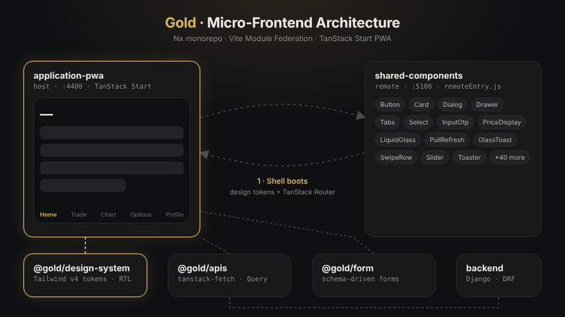
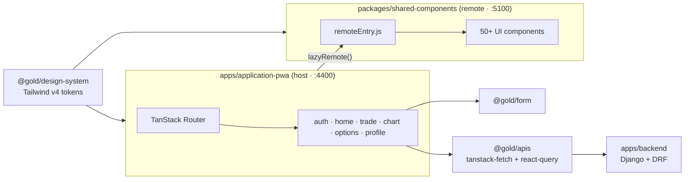

<div align="center">

# Gold — Micro-Frontend Gold Trading App

A gold-trading **PWA** built as an **Nx monorepo** of micro-frontends: a TanStack Start shell that loads a shared UI library at runtime through **Vite Module Federation**, backed by a typed API layer and a Django REST backend.




</div>

---

## Highlights

- **Runtime-shared UI** — `shared-components` is a Module Federation remote exposing 50+ components (`Button`, `Dialog`, `Drawer`, `PriceDisplay`, `LiquidGlass`, `PullRefresh`, `SwipeRow`, …) that any app loads with `lazyRemote()`. React is shared as a singleton.
- **Installable PWA** — TanStack Start + TanStack Router with file-based routes, `vite-plugin-pwa`, splash screens and an install prompt.
- **Trading screens** — Home, Trade, Chart (TanStack Charts), Options and Profile, with a mobile bottom nav and a desktop side-nav layout.
- **Security flows** — OTP login, PIN lock/unlock, two-factor and **WebAuthn** (passkeys).
- **One design system** — Tailwind CSS v4 gold tokens, HeroUI theme, Base UI primitives, light/dark and **RTL-first** (Persian) with an LTR toggle.
- **Typed data layer** — `@gold/apis` wraps [`tanstack-fetch`](https://www.npmjs.com/package/tanstack-fetch) and TanStack Query into ready-made query/mutation options.
- **Schema-driven forms** — `@gold/form` generates forms and default values from a schema definition.
- **Quality gates** — ESLint, Prettier, strict `tsc`, Vitest, Husky + lint-staged and Conventional Commits via commitlint.

## Architecture



## Repository structure

```
apps/
  application-pwa/       # React PWA (TanStack Start) — Module Federation host
    src/modules/         # feature modules: auth, home, market, trade, chart, options, profile, shell
    src/routes/          # file-based routes: (auth)/login, (auth)/pin, (app)/home, trade, chart, …
  backend/               # Django + DRF + Channels API (Docker Compose, PostgreSQL)
packages/
  design-system/         # Tailwind v4 tokens, HeroUI theme, RTL + global CSS
  shared-components/     # Shared UI components — Module Federation remote
  apis/                  # Typed API clients and query/mutation options
  form/                  # Schema-driven form generator
```

| Package / App             | Description                                         |
| ------------------------- | --------------------------------------------------- |
| `@gold/application-pwa`   | Gold-trading PWA, Module Federation host (port **4400**) |
| `@gold/shared-components` | Styled UI components, Module Federation remote (port **5100**) |
| `@gold/design-system`     | Gold tokens, portal setup, component utilities      |
| `@gold/apis`              | Typed API clients and query/mutation options        |
| `@gold/form`              | Schema-driven forms and default-value builders      |
| `backend`                 | Django REST API — see [`apps/backend/README.md`](apps/backend/README.md) |

## Tech stack

| Layer      | Tools |
| ---------- | ----- |
| Frontend   | React 19, TypeScript, TanStack Start / Router / Query / Store / Charts, Motion |
| UI         | Tailwind CSS v4, HeroUI, Base UI |
| Federation | `@module-federation/vite`, `@module-federation/runtime` |
| Tooling    | Nx, pnpm workspaces, Vite, Vitest, ESLint, Prettier, Husky, commitlint |
| Backend    | Django, Django REST Framework, Channels, PostgreSQL, drf-spectacular |

## Getting started

**Prerequisites:** Node.js, [pnpm](https://pnpm.io/) and Docker (for the backend).

```bash
pnpm install
pnpm dev:application-pwa   # starts the PWA and the shared-components remote
```

- PWA: http://localhost:4400
- Shared components: http://localhost:5100

```bash
pnpm stop                  # free ports 4200, 4400, 5100
```

Run projects individually:

```bash
nx dev application-pwa
nx dev shared-components
```

Backend (see [`apps/backend`](apps/backend/README.md)):

```bash
cd apps/backend && docker compose up
```

## Using federated components

Import the design-system CSS:

```css
@import "@gold/design-system/styles.css";
```

Load components from the remote:

```tsx
import { lazyRemote } from "./mf"

const Button = lazyRemote("shared_components", "Button")
const Dialog = lazyRemote("shared_components", "Dialog")

// Compound components keep the Base UI API:
// <Dialog><Dialog.Trigger>...</Dialog.Trigger></Dialog>
```

Wrap the app root with the `gold-root` class for correct popup stacking (Base UI requirement).

## Scripts

| Command              | What it does                                   |
| -------------------- | ---------------------------------------------- |
| `pnpm build`         | Build shared-components, form and the PWA      |
| `pnpm test`          | Run Vitest for form, apis and shared-components |
| `pnpm lint`          | Lint every project                             |
| `pnpm typecheck`     | Strict TypeScript check across the workspace   |
| `pnpm format`        | Format with Prettier                           |
| `pnpm preview:application-pwa` | Preview the production PWA build     |

## Conventions

Component folders, module layout, export rules and the UI/hooks split are documented in [`AGENTS.md`](AGENTS.md). Commits follow [Conventional Commits](https://www.conventionalcommits.org/).

## License

Released under the [MIT License](LICENSE).
